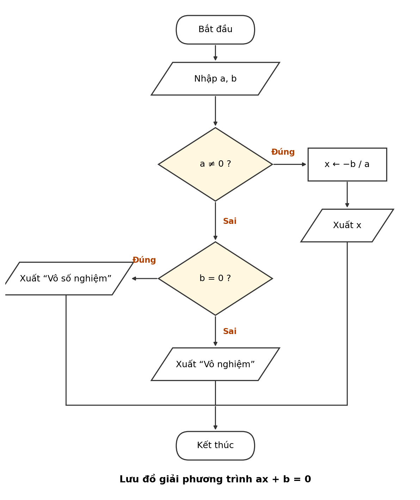
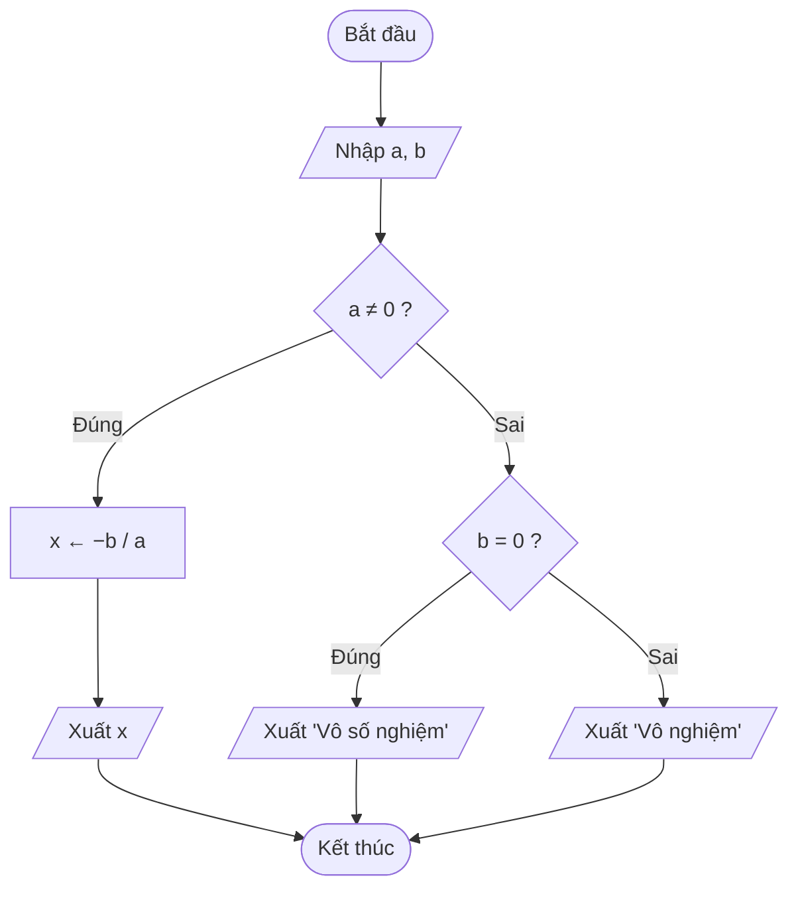

/*
 * Bài: Buoi01_A6 - Mã giả, lưu đồ, chạy tay: phương trình ax + b = 0
 * Sinh viên: [họ tên] - MSSV: [mã số]
 * Ngày: 20/10/2026
 */

# Buoi01_A6 – Giải phương trình bậc nhất ax + b = 0

## Bước 1. Vào / ra

- **Vào:** hai số thực `a`, `b`.
- **Ra:** nghiệm `x`, hoặc thông báo "Vô số nghiệm" / "Vô nghiệm".

## Bước 2. Phân tích các trường hợp

1. `a ≠ 0`: phương trình có một nghiệm `x = −b / a`.
2. `a = 0` và `b = 0`: `0x + 0 = 0` đúng với mọi `x` → **vô số nghiệm**.
3. `a = 0` và `b ≠ 0`: `0x + b = 0` không bao giờ đúng → **vô nghiệm**.

## Bước 3. Mã giả

```
BẮT ĐẦU
  NHẬP a, b
  NẾU a ≠ 0 THÌ
    x ← -b / a
    XUẤT "Nghiệm x = ", x
  NGƯỢC LẠI
    NẾU b = 0 THÌ
      XUẤT "Vô số nghiệm"
    NGƯỢC LẠI
      XUẤT "Vô nghiệm"
    KẾT THÚC NẾU
  KẾT THÚC NẾU
KẾT THÚC
```

## Bước 4. Lưu đồ



Bản Mermaid (GitHub tự vẽ thành hình):



## Bước 5. Chạy tay

| a  | b  | a ≠ 0 ? | b = 0 ?      | Kết quả xuất      |
|----|----|---------|--------------|-------------------|
| 2  | −4 | Đúng    | (không xét)  | Nghiệm x = 2      |
| 0  | 0  | Sai     | Đúng         | Vô số nghiệm      |
| 0  | 5  | Sai     | Sai          | Vô nghiệm         |

Giải thích dòng 1: `a = 2 ≠ 0` → `x = −(−4) / 2 = 2`.
Ba bộ dữ liệu đi qua đủ ba nhánh của lưu đồ.
