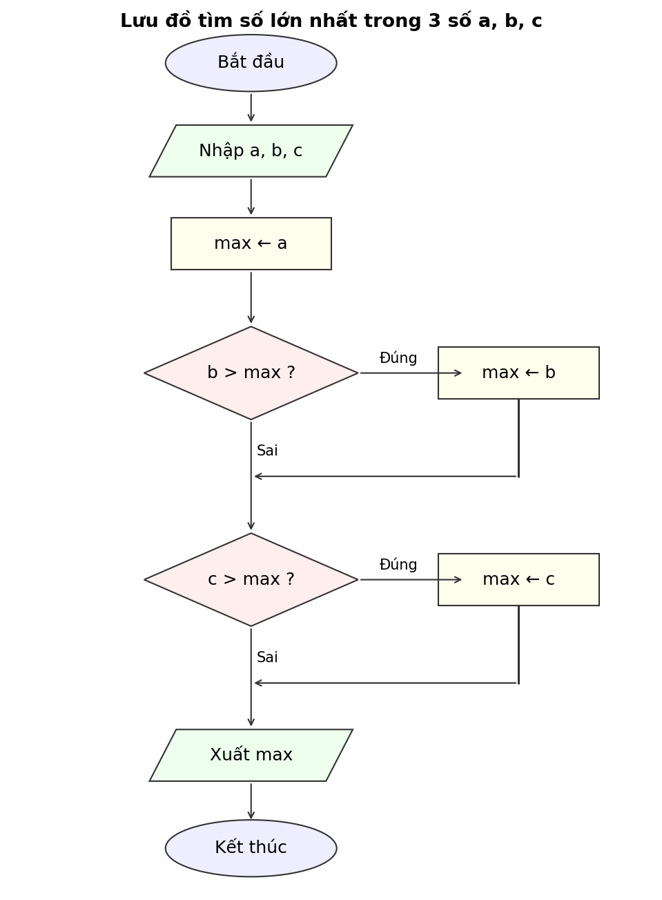

<!--
  Bài: Buoi01_B4 - Số lớn nhất trong 3 số
  Sinh viên: [Nguyễn Ngọc Yến Nhi] - MSSV: [31251024414]
  Ngày: 20/10/2026
-->

# Buoi01_B4 – Số lớn nhất trong 3 số

## 1. Xác định vào/ra

- **Đầu vào:** ba số thực a, b, c.
- **Đầu ra:** số lớn nhất trong ba số, ký hiệu `max`.

## 2. Ý tưởng

Giả sử `a` là số lớn nhất, rồi lần lượt so sánh với `b`, sau đó với `c`; số nào lớn hơn `max` hiện tại thì gán vào `max`. Cách này không phụ thuộc vào việc các số có bằng nhau hay không (dùng `>` nên khi bằng nhau thì giữ nguyên).

## 3. Mã giả

```text
BẮT ĐẦU
  NHẬP a, b, c
  max ← a
  NẾU b > max THÌ
    max ← b
  KẾT THÚC NẾU
  NẾU c > max THÌ
    max ← c
  KẾT THÚC NẾU
  XUẤT "Số lớn nhất = ", max
KẾT THÚC
```

## 4. Lưu đồ



## 5. Chạy tay

| a | b | c | max ← a | b > max ? | max sau bước 2 | c > max ? | max sau bước 3 | Kết quả xuất |
|---|---|---|---------|-----------|----------------|-----------|----------------|--------------|
| 3 | 7 | 5 | 3 | Đúng (7 > 3) | 7 | Sai (5 > 7) | 7 | **Số lớn nhất = 7** |
| 9 | 2 | 9 | 9 | Sai (2 > 9) | 9 | Sai (9 > 9) | 9 | **Số lớn nhất = 9** |
| −1 | −5 | −3 | −1 | Sai (−5 > −1) | −1 | Sai (−3 > −1) | −1 | **Số lớn nhất = −1** |
| 1 | 2 | 3 | 1 | Đúng (2 > 1) | 2 | Đúng (3 > 2) | 3 | **Số lớn nhất = 3** |

> Dòng cuối (1, 2, 3) là bộ dữ liệu bổ sung. Ba bộ đề bài chưa có bộ nào đi qua nhánh **Đúng** của câu hỏi `c > max ?`, trong khi khi kiểm thử cần mỗi nhánh được đi qua ít nhất một lần.

## 6. Nhận xét

- Cả 3 bộ dữ liệu của đề đều cho kết quả đúng: 7, 9, −1.
- Bộ (9, 2, 9) có hai số bằng nhau cùng là lớn nhất: thuật toán vẫn đúng vì giá trị `max` là 9 dù lấy từ `a` hay `c`.
- Bộ (−1, −5, −3) gồm toàn số âm: nhờ khởi tạo `max ← a` (không khởi tạo bằng 0) nên kết quả đúng là −1. Nếu khởi tạo `max ← 0` thì sẽ sai.
