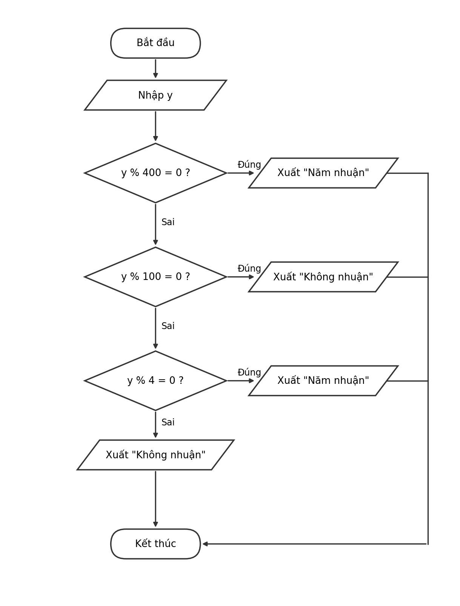

# Buoi01_B5 – Năm nhuận

**Sinh viên:** Nguyễn Ngọc Yến Nhi – **MSSV:** [31251024414] – **Lớp:** [EE0001]
**Ngày:** 20/10/2026

## Đề bài
Nhập một năm `y`, xuất "Năm nhuận" hoặc "Không nhuận". Viết mã giả, vẽ lưu đồ, chạy tay với 2024, 1900, 2000, 2026.

## Bước 1. Vào / ra
- Đầu vào: số nguyên `y` (năm).
- Đầu ra: thông báo "Năm nhuận" hoặc "Không nhuận".

## Bước 2. Phân tích
Năm nhuận là năm chia hết cho 400, **hoặc** chia hết cho 4 nhưng không chia hết cho 100.
Kiểm tra theo thứ tự: chia hết cho 400 → chia hết cho 100 → chia hết cho 4.

1. `y % 400 = 0` → **nhuận** (dừng, không xét tiếp).
2. Ngược lại, `y % 100 = 0` → **không nhuận** (chia hết cho 100 nhưng không chia hết cho 400).
3. Ngược lại, `y % 4 = 0` → **nhuận**; nếu không → **không nhuận**.

Thứ tự này quan trọng: nếu hỏi "chia hết cho 4" trước thì 1900 sẽ bị xếp nhầm là nhuận.

## Bước 3. Mã giả
```
BẮT ĐẦU
  NHẬP y
  NẾU y % 400 = 0 THÌ
    XUẤT "Năm nhuận"
  NGƯỢC LẠI
    NẾU y % 100 = 0 THÌ
      XUẤT "Không nhuận"
    NGƯỢC LẠI
      NẾU y % 4 = 0 THÌ
        XUẤT "Năm nhuận"
      NGƯỢC LẠI
        XUẤT "Không nhuận"
      KẾT THÚC NẾU
    KẾT THÚC NẾU
  KẾT THÚC NẾU
KẾT THÚC
```

## Bước 4. Lưu đồ


## Bước 5. Chạy tay

| y | y % 400 = 0 ? | y % 100 = 0 ? | y % 4 = 0 ? | Kết quả xuất |
|---|---|---|---|---|
| 2024 | Sai (2024 % 400 = 24) | Sai (2024 % 100 = 24) | Đúng (2024 % 4 = 0) | Năm nhuận |
| 1900 | Sai (1900 % 400 = 300) | Đúng (1900 % 100 = 0) | (không xét) | Không nhuận |
| 2000 | Đúng (2000 % 400 = 0) | (không xét) | (không xét) | Năm nhuận |
| 2026 | Sai (2026 % 400 = 26) | Sai (2026 % 100 = 26) | Sai (2026 % 4 = 2) | Không nhuận |

Kết quả khớp với đáp án của đề: 2024 và 2000 nhuận; 1900 và 2026 không nhuận.

Bốn bộ dữ liệu đi qua đủ các nhánh của lưu đồ:
- 2000: nhánh Đúng của câu hỏi 400.
- 1900: nhánh Đúng của câu hỏi 100.
- 2024: nhánh Đúng của câu hỏi 4.
- 2026: nhánh Sai của câu hỏi 4.

## Kiểm tra bằng code (tùy chọn)
Chạy `dotnet run` trong thư mục này sẽ in:
```
2024: Năm nhuận
1900: Không nhuận
2000: Năm nhuận
2026: Không nhuận
```
