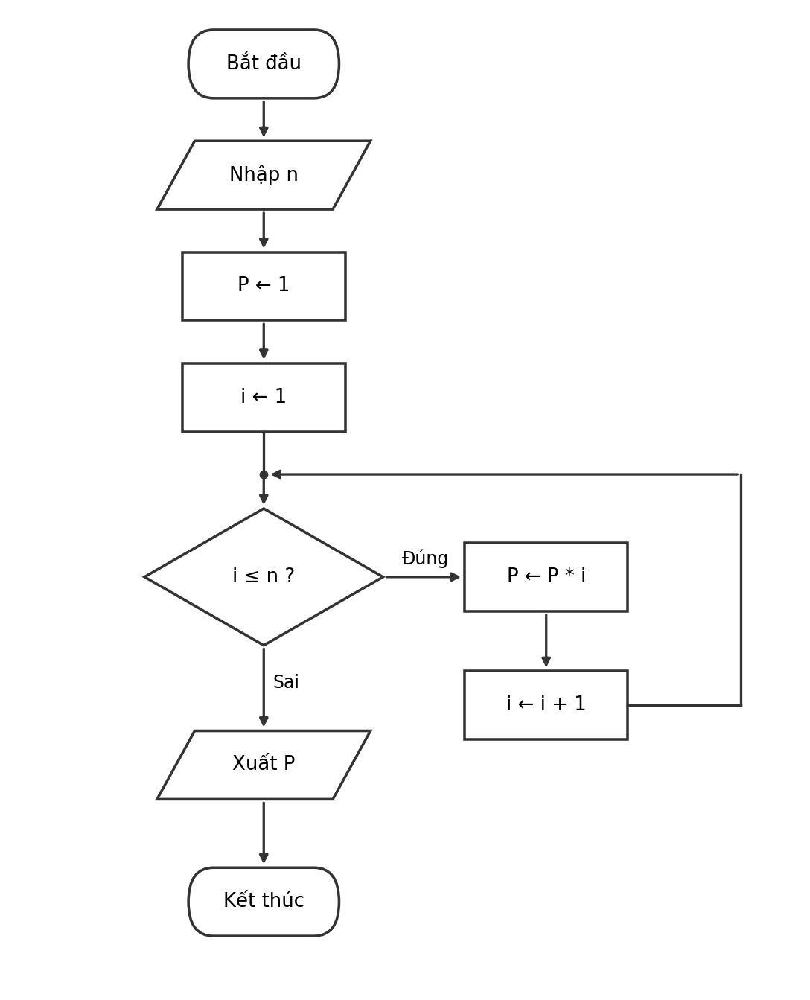

# Buoi01_B6 – Tính n!

**Sinh viên:** Nguyễn Ngọc Yến Nhi - **MSSV:** [31251024414] - **Lớp:** [EE0001]
**Ngày:** 20/10/2026

## Đề bài
Tính P = n! = 1 × 2 × … × n với n ≥ 0. Viết mã giả, vẽ lưu đồ, lập bảng chạy tay với n = 5. Kiểm tra thêm n = 0.

## Bước 1. Vào / ra
- Đầu vào: số nguyên n ≥ 0.
- Đầu ra: P = n!.

## Bước 2. Ý tưởng
Cấu trúc giống thuật toán tính tổng 1 + 2 + … + n, chỉ khác hai chỗ:
1. Biến tích lũy `P` khởi tạo bằng **1** (không phải 0), vì 1 là phần tử trung hòa của phép nhân.
2. Dùng phép **nhân** `P ← P * i` thay cho phép cộng.

Biến đếm `i` chạy từ 1 đến n. Khi n = 0, vòng lặp không chạy lần nào nên P giữ nguyên giá trị 1, đúng với quy ước 0! = 1.

## Bước 3. Mã giả
```
BẮT ĐẦU
  NHẬP n
  P ← 1
  i ← 1
  TRONG KHI i ≤ n LÀM
    P ← P * i
    i ← i + 1
  KẾT THÚC TRONG KHI
  XUẤT P
KẾT THÚC
```

## Bước 4. Lưu đồ


## Bước 5. Chạy tay với n = 5

Khởi tạo: P = 1, i = 1.

| Lần kiểm tra | i | i ≤ n ? | P trước | P ← P * i | i ← i + 1 |
|---|---|---|---|---|---|
| 1 | 1 | 1 ≤ 5 Đúng | 1 | 1 | 2 |
| 2 | 2 | 2 ≤ 5 Đúng | 1 | 2 | 3 |
| 3 | 3 | 3 ≤ 5 Đúng | 2 | 6 | 4 |
| 4 | 4 | 4 ≤ 5 Đúng | 6 | 24 | 5 |
| 5 | 5 | 5 ≤ 5 Đúng | 24 | 120 | 6 |
| 6 | 6 | 6 ≤ 5 Sai | – | – | – |

Thoát vòng lặp, xuất **P = 120**. Đúng với 5! = 120.

## Kiểm tra thêm với n = 0

Khởi tạo: P = 1, i = 1.

| Lần kiểm tra | i | i ≤ n ? | Kết quả |
|---|---|---|---|
| 1 | 1 | 1 ≤ 0 Sai | thoát ngay, không nhân lần nào |

Xuất **P = 1**. Thuật toán cho ra 1, đúng với 0! = 1.

## Kiểm tra bằng code (tùy chọn)
Chạy `dotnet run` trong thư mục này sẽ in:
```
5! = 120
0! = 1
```
